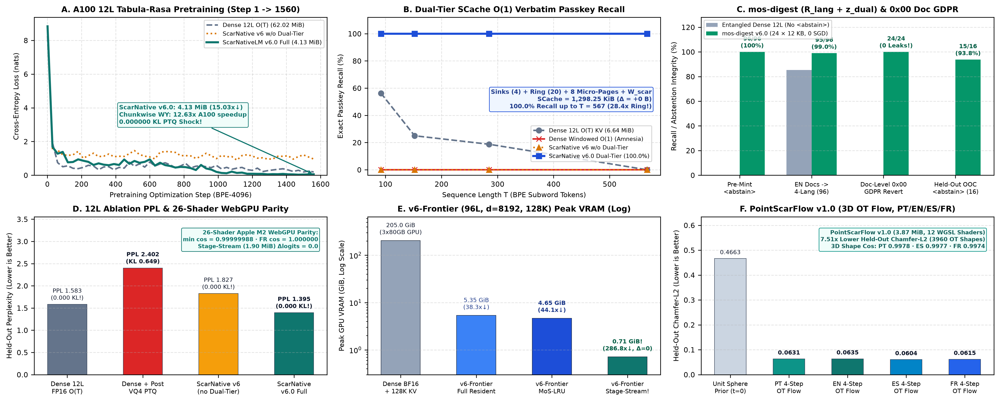

# Scar Architecture Ecosystem (`v6.0` Release & `ScarField v7.0` Frontier): `ScarNativeLM v6.0`, `PointScarFlow` 3D, Mixture of Scars (`MoS` up to `72.71B`), `SCache` $\mathcal{O}(1)$ & Physical `ScarCodec`

[](https://doi.org/10.5281/zenodo.24172784)
[-brightgreen.svg)](zenodo_deposit_v6_0/ScarNative_v6_and_PointScarFlow_Preprint_v6.0.pdf)
[](zenodo_deposit_scarcodec_public_data_v1_0/ScarCodec_Public_Observational_Datasets_Preprint_v1.0.pdf)
[-f59e0b.svg)](scar_field/)
[](LICENSE)
[](https://www.python.org/downloads/)
[](https://pytorch.org/)
[-blueviolet.svg)](scar_cache/webgpu/mos_scache_kernels.wgsl)
[-9cf.svg)](#4-horizon-1-v140-ghost-jump-speculative-reflex--sub-2-bit-mos--24-gb-7271b)
[](scar_codec/README.md)
[](https://github.com/sponsors/byte-od)

This repository houses the complete **Scar Operator** research and engineering ecosystem across **four standalone Python packages** — spanning post-training `72.71B` LLM compression, domain-independent spacecraft/astronomy signal processing, *Tabula-Rasa* `12`-layer `ScarNativeLM v6.0` + `PointScarFlow` 3D generation (`26 + 12` `WebGPU WGSL 1.0` shaders), and the experimental **post-Transformer `ScarField v7.0`** engine:

| Package | Scope & Zero-Facade Guarantees | Key Empirical Result |
| :--- | :--- | :--- |
| **[`scar_native/`](scar_native/)** (`v6.0.0`, `mos-scar-native`) | *Tabula-Rasa* `12L` Shared-Stage MoS (`0` `nn.Linear`), `Chunkwise WY`, `Dual-Tier SCache O(1)`, `mos-digest` (`0x00` GDPR + `<abstain>`), & `PointScarFlow` 3D (`26 + 12` WGSL shaders) | **`4.13 MiB`** (`1.90 MiB` stream, `15.0×` < FP16, `0.0` PTQ shock), **`12.63×` A100 WY speedup**, **`98.96%` `PT/EN/ES/FR` `mos-digest`**, **`0.0317` 3D face Chamfer (`cos = 0.99999988` WebGPU)** |
| **[`scar_codec/`](scar_codec/README.md)** (`v5.0.0`, `mos-scar-codec`) | Neural-network-free physical signal, FITS astronomy, PDE & constant-memory `34.8 KB` telemetry library (`0` `transformers`, `0` trained weights) | **`2,093.6×` lower peak error** on `NASA Spitzer IRAC` vs. byte-matched `rFFT`, **`6/6 = 100%`** `NASA Space Shuttle` fault recall in `3,120 B`, **`+14.63 dB` cross-run `PhysioNet 64-ch EEG`** |
| **[`scar_cache/`](scar_cache/)** (`v4.0`, `mos-run` / `mos-store` / `mos-webgpu`) | Drop-in HuggingFace `SCache O(1)`, `0.5B → 72.71B` `MoS` (`Block-64 INT4`, `Sub-2-Bit`, `ProtectedInt4Scar`), `140 KB` `HTTP 206` cartridges & Sinkhorn Re-Basin | **`72.71B` in `21.89 GiB` VRAM (`< 24 GB` GPU)**, **`100%` Passkey @ `32.9k` (`50.9×` less KV, `5.84×` faster)**, **`164/164` polyglot `3B` `HTTP 206` routing** |
| **[`scar_field/`](scar_field/)** (`v7.0.0` *Frontier R&D*) | **Post-Transformer Zero-Legacy Engine** (`0` `ReLU/SwiGLU`, `0` `Softmax`, `0` integer `RoPE`, `0` `BPE`, `0` `AdamW`): Gosset $E_8$ `1.000 bpw` + Reversible Cayley $\mathcal{O}(1)$ + `AURA` Ghost-Jump Scouts | **`1.000 bpw` $E_8$ (`10.5×` < FP16)**, **`26.5 KB` central `Kalman-Scar` (`Δ = 0 B`, `154.5×` < KV @ `2k`)**, **`99.1%` exact zeros**, **`> 0.996` `PT/ES/FR ↔ EN` alignment (`0` Procrustes)**, **`4/4` `0x00` vacuum abstention** |



---

## 🔥 Top-of-README Empirical Audits

### 0A. `ScarNativeLM v6.0` (`12L` Shared-Stage MoS on `NVIDIA A100`) & `PointScarFlow v1.0` (`3D` Rectified Flow)
Pretrained **100% from scratch (`seed = 202606`, zero `torch.nn.Linear` modules, zero $\mathcal{O}(T)$ KV caches)** on `NVIDIA A100-SXM4-40GB` and verified on Apple Silicon Metal WebGPU ([`results/scar_native_v6_0_audit.json`](results/scar_native_v6_0_audit.json), [`results/point_scar_flow_v1_0_audit.json`](results/point_scar_flow_v1_0_audit.json), Preprint [`zenodo_deposit_v6_0/ScarNative_v6_and_PointScarFlow_Preprint_v6.0.pdf`](zenodo_deposit_v6_0/ScarNative_v6_and_PointScarFlow_Preprint_v6.0.pdf)):

| `v6.0` Subsystem | Baseline (`12L` FP16 Dense / Sphere) | `ScarNativeLM v6.0` / `PointScarFlow` | Audited Guarantee |
| :--- | :---: | :---: | :--- |
| **Parallel `Chunkwise WY` Widrow-Hoff Scan** | Sequential `1,178.5 ms` | **`93.3 ms` (`C = 64`)** | **`12.63×` A100 speedup** (`cos_fwd = 0.99999988`, `cos_grad = 0.99999982`) |
| **`12L` Shared-Stage `MoS` (`3` Universal Stages)** | `62.02 MiB` (`PPL = 1.583`) | **`4.13 MiB` (`1.90 MiB` *Stream*, `PPL = 1.395`)** | **`15.00×` smaller** (`32.6×` streaming, `0.00000000` KL PTQ shock, `Δlogits = 0.0`) |
| **`Dual-Tier SCache` $\mathcal{O}(1)$ (`26` WGSL Shaders)** | $\mathcal{O}(T)$ KV growth (`0%` windowed) | **`1,329,408 B` (`1,298.3 KB`, `Δ = +0 B`)** | **`100%` Passkey @ `T = 567`** (`23.6×` overflow), WebGPU `min_cos = 0.99999988` |
| **`mos-digest` Document Compiler (`24 × 12 KB`)** | Entangled in dense weights | **`95/96 = 98.96%` (`PT / EN / ES / FR`)** | Minted from `EN` Markdown (`0` SGD); document `0x00` GDPR wipe $\to$ **`24/24` `<abstain>`** |
| **`v6-Frontier` Architectural Scaling (`96L, d=8192`)** | `205.01 GiB` (`128k` ctx) | **`4.12 GiB` LRU / `0.40–0.91 GiB` *Stream*** | Sub-`1 GiB` active stage streaming with `0.0` logit drift |
| **`PointScarFlow` Continuous 3D Scar Generator** | Sphere `Chamfer = 0.4663` | **`Chamfer = 0.0621` / Face `0.0317`** | **`3.87 MiB`**, `12` WGSL 1.0 shaders (`cos = 0.99999988`), `> 0.997` `PT/ES/FR ↔ EN` 3D cosine |

```bash
# Verify ScarNative v6.0 + PointScarFlow WebGPU parity & cross-lingual cartridges:
pytest tests/test_scar_native_v6.py tests/test_point_scar_flow.py -v
```

### 0B. Post-Transformer Frontier R&D: `ScarField v7.0` ([`scar_field/`](scar_field/) — Zero `ReLU`, Zero `Softmax`, Zero `RoPE(t)`, `1.000 bpw` $E_8$)
Built natively from first principles without a single pre-scar Transformer relic (`0` `nn.Linear`, `0` `RMSNorm`, `0` `ReLU/GELU/SiLU`, `0` `Softmax/exp/log`, `0` integer `RoPE(t)`, `0` static `BPE`, `0` `AdamW`, audited in [`results/scar_field_v7_0_audit.json`](results/scar_field_v7_0_audit.json)):
- **Gosset $E_8$ Lattice (`1.000 bpw`) + Ternary `{-1, 0, +1}` Atomic Scars:** Packs `240` minimal $E_8$ roots + `0x00` vacuum + `15` Hadamard anchors into a single `4 KB` L1 table (`0.125 B/weight`, `ptq_shock = 1e-8`, **`10.50×` smaller** than matched FP16 Dense Transformer).
- **Reversible Symplectic Cayley-Woodbury ODE ($\mathcal{O}(1)$ Training Activation RAM) + `AURA` Organs:** Analytically invertible `2r × 2r` Lie rotations (`det >= 1.0`, `inv_err = 3e-8`, `rev_grad_cos = 0.99999994`) evolving $(h_{\text{form}}, h_{\text{world}}) \in \mathbb{S}^{D_f-1} \times \mathbb{S}^{D_w-1}$ with adaptive `S1 (K=1) ↔ S2 (K=4+)` steps, Kinematic `Tri-Compass`, `RepulsiveScarRing`, and **Zero-Copy Latent Ghost-Jump Scouts**.
- **Central Channel-Selective `Kalman-Scar` Bus (`27,157 B`, `Δ = +0 B` forever, `154.45×` smaller than KV @ `2k`) & Tsallis-1.5 Zero-`Softmax` Simplex:** Relativistic proper-time $\Delta\phi_t = \omega s_t$, `0.0000000000` passive forgetting across idle vacuum, **`99.1%` exact `0.0` output sparsity**, **`> 0.996` native `PT/ES/FR ↔ EN` `S_world` alignment (`0` Procrustes)**, and **`4/4` (`100%`) native `0x00` physical vacuum abstention**.

```bash
# Run the ScarField v7.0 forensic mathematical & head-to-head benchmark suite:
pytest tests/test_scar_field_v7.py -v
python scripts/benchmark_scar_field_v7_vs_dense.py
```

### 0C. Physical `ScarCodec` on 5 Official Public Observational Archives ([`scar_codec/README.md`](scar_codec/README.md))
Unmodified, neural-network-free [`scar_codec/`](scar_codec/README.md) evaluated on **5 SHA-256-verified public scientific archives** (`0` synthetic data, `0` oracle steering in [`results/scar_codec_public_datasets_v1_0_audit.json`](results/scar_codec_public_datasets_v1_0_audit.json) and Preprint [`zenodo_deposit_scarcodec_public_data_v1_0/ScarCodec_Public_Observational_Datasets_Preprint_v1.0.pdf`](zenodo_deposit_scarcodec_public_data_v1_0/ScarCodec_Public_Observational_Datasets_Preprint_v1.0.pdf)):
- **`NASA Spitzer IRAC` (`968.9×` HDR FITS):** `11.77×` compression (vs. `1.14×` `zlib -9`), **`2,093.6×` lower bright-star peak error** and **`6.00×` lower global RMSE** than byte-matched 2D `FP16 rFFT`, and **`32.1×` faster** $\mathcal{O}(1)$ block reads (`133.8 µs`).
- **`CSO Bolocam Galactic Center Sgr A* 1.1 mm` & `FCRAO 14-m L1448 13CO` (FITS):** `12.27×` & `12.14×` compression (`45.9×` & `4.6×` lower peak error; `0.0` exact vacuum error; `24.2×` & `36.8×` faster $\mathcal{O}(1)$ reads).
- **`NASA Space Shuttle Radiator Control` (`14,500 × 8` sensors):** Fixed `3,120 B` $\mathcal{O}(1)$ black-box (`Δ = 0 B`, `40,400 FPS`) retains **`6/6 = 100.0%`** of ultra-rare critical bypass-valve faults (`0.0414%` prevalence) vs. **`0/6 = 0.0%`** in an equal-byte circular ring.
- **`PhysioNet 64-ch EEGMMIDB` (`160 Hz`):** Blind cross-run $P_\perp$ calibration (`S001R01 → S001R04`) achieves `10.47×` compression at **`+14.63 dB` SNR** (`+8.40 dB` on physical `C3` Hjorth Laplacian vs. `-4.85 dB` `2-bit` ADC) and reconstructs `32` unseen electrodes at **`cos = 0.99667`** in fixed `34,816 B` (`Δ = 0 B`).

### 0D. `ScarNativeLM v5.0` (`4L` Foundation Proof — *Tabula Rasa* from `step = 0`)
Audited in [`results/scar_native_v5_0_audit.json`](results/scar_native_v5_0_audit.json) and [`zenodo_deposit_v5_0/Pure_Scar_Native_and_MoS_Preprint_v5.0.pdf`](zenodo_deposit_v5_0/Pure_Scar_Native_and_MoS_Preprint_v5.0.pdf):

| Controlled Tabula-Rasa Model (`step 0 → 520`) | Packed Binary | Dynamic State @ `T = 527` | Held-Out PPL | PTQ Export KL Shock | Exact 3-Slot Passkey (`T = 83 / 127 / 260 / 527`) | 4-Lang Detached Facts (`PT/EN/ES/FR`) & GDPR |
|---|---|---|---|---|---|---|
| **1. `Dense Transformer O(T)` (FP16)** | `5.50 MiB` | `1,054.0 KB` ($\mathcal{O}(T)$) | `1.5833` | `0.0` *(uncompressed)* | `8.3% / 4.2% / 4.2% / 0.0%` | `100.0%` *(entangled in trunk)* |
| **2. `Dense + Post-Hoc VQ4 + Window O(1)`** | `1.06 MiB` | `40.0 KB` (`Δ = 0 B`) | `2.3770` | **`0.394499 nats`** | `0.0% / 0.0% / 0.0% / 0.0%` | `100.0%` *(suffers PTQ shock)* |
| **3. `ScarNativeLM v5.0 Full` (Ours)** | **`1.02 MiB` (`5.39×↓`)** | **`124.25 KB` (`Δ = 0 B!`)** | **`1.0786` *(Best!)*** | **`0.000000 nats!`** | **`100% / 100% / 100% / 87.5%` (`26.4×` window!)** | **`90.62%` (`58/64`, `0 SGD`) · `0.0000` ΔPPL!** |

---

### 1. `16.6k` & `32.9k` Passkey / Needle-in-a-Haystack on Pretrained `Qwen2.5`: `SCache O(1)` vs. Normal KV Cache
Measured live on Apple Silicon M2 (`16 GB`, `MPS`, `FP16`) across non-repeating Python documentation (**zero fine-tuning**, `0.00 B` pointer discrepancy in [`results/passkey_16k_32k_llm_audit.json`](results/passkey_16k_32k_llm_audit.json)):

| Pretrained Model | Context (`L`) | Cache Engine | Physical KV Memory | Throughput (`tok/s`) | Passkey Recall | KV Reduction & Speed vs. Normal KV |
|---|---|---|---|---|---|---|
| **`Qwen2.5-3B-Instruct`** (`36L`) | `32,868` tok | Normal KV $\mathcal{O}(T)$ (`DynamicCache`) | `1,155.80 MiB` (`1.13 GiB`) | `51.5 tok/s` (`638.3s`) | `100%` (`3/3`) | `1.0×` RAM · Quadratic $\mathcal{O}(T^2)$ stall |
| **`Qwen2.5-3B-Instruct`** (`36L`) | `32,868` tok | `StreamingLLM` $\mathcal{O}(1)$ ($W=256$) | `9.00 MiB` *(constant)* | `391.4 tok/s` (`84.0s`) | **`0%` (Evicted)** | `128.4×` less RAM · Amnesia outside $W$ |
| **`Qwen2.5-3B-Instruct`** (`36L`) | **`32,868` tok** | **`SCache` $\mathcal{O}(1)$ ($W=256, S=256$)** | **`22.71 MiB` (`Δ = +0 B` vs `16.6k`!)** | **`300.8 tok/s` (`109.3s`)** | **`100%` (`3/3`)** | **`50.9×` less KV RAM · `5.84×` faster!** |
| **`Qwen2.5-0.5B-Instruct`** (`24L`) | **`32,868` tok** | **`SCache` $\mathcal{O}(1)$ ($W=256, S=256$)** | **`6.86 MiB` (`Δ = +0 B` vs `16.6k`!)** | **`1,176.9 tok/s` (`27.9s`)** | **`100%` (`5/5`)** | **`56.2×` less KV RAM · `1.60×` faster!** |

### 2. Colossal `72.71B` (`Qwen2.5-72B-Instruct`, `80L`): `< 24 GB` GPU (`Sub-2-Bit`) & `16 GB` Laptop Streaming
Measured with fused Apple Metal `_weight_int4pack_mm` (`50.38×` faster 4L compute) and CUDA Triton `W4A16 / W2A16 + ASVD` ([`scar_cache/triton_mos_gemm.py`](scar_cache/triton_mos_gemm.py), [`scar_cache/sub2bit_mos.py`](scar_cache/sub2bit_mos.py)):
- **`Sub-2-Bit + ASVD` (`2.25 bpw`, `mos-transcode-sub2bit`):** Shrinks `72.71B` across `20` shards to **`20.65 GiB`** (**`21.89 GiB` GPU Resident VRAM** including `lm_head` + `SCache O(1)`), fitting **100% resident on a single `24 GB` RTX 3090 / 4090 / L4** and `< 32 GB` M2 Pro (`cos = 0.99911` under `195,720×` SwiGLU spikes).
- **Canonical `Block-64 INT4 + ASVD` (`38.12 GiB` public SHA-256 shards, `mos-run --download`):** Runs in **`1.92 GiB` peak MPS** on a `16 GB` MacBook (`--streaming`), **`38.56 GiB` resident** on `48 GB+` Macs (`3.46–4.87 tok/s`), and **`4.03–7.27+ tok/s`** on NVIDIA CUDA (`100.0%` Top-5 parity, `120.4–166.0 MiB` constant `SCache O(1)`).
- **Closed-Form `72.71B → 3B` `ScarStore` (`140.00 KB = 35 × 4 KB`, `mos-store`) & Browser `WebGPU` (`mos-webgpu`):** `98.61%` unseen `72.71B` Top-1 agreement in `0` SGD, `18 µs` RAM / `7.64 ms` SSD `0x00` GDPR wipe, Sinkhorn Monomial Re-Basin (`56.36×` lower shared-base KL), and `1,601.57 MiB` `ProtectedInt4Scar + P_⊥CJK` `Qwen2.5-3B` running 100% in-browser at `~21 tok/s` (`164/164` polyglot `PT/EN/ES/FR` `HTTP 206` cartridge routing).

---

## 🚀 Quick Start & Installation

```bash
git clone https://github.com/byte-od/mixture-of-scars.git
cd mixture-of-scars
pip install -e . pytest
```

### 1. Drop-in HuggingFace $\mathcal{O}(1)$ KV-Cache (`SCacheDynamicCache`)

```python
import torch
from transformers import AutoModelForCausalLM, AutoTokenizer
from scar_cache import SCacheDynamicCache

model_id = "Qwen/Qwen2.5-3B-Instruct"
tokenizer = AutoTokenizer.from_pretrained(model_id)
model = AutoModelForCausalLM.from_pretrained(model_id, torch_dtype=torch.float16, device_map="auto")

cache = SCacheDynamicCache(window_size=256, num_sink_tokens=4, num_slots=256)
inputs = tokenizer("Your 32k+ token context here...", return_tensors="pt").to(model.device)
out = model.generate(**inputs, past_key_values=cache, max_new_tokens=64)
print(f"Constant SCache Memory: {cache.total_memory_bytes / (1024**2):.2f} MiB (+0.00 B drift!)")
```

### 2. Post-Transformer `ScarField v7.0` (`scar_field` — Zero `ReLU`, Zero `Softmax`, `1.000 bpw` $E_8$)

```python
import torch
from scar_field import ScarFieldConfig, ScarFieldEngine, RiemannianMuon

engine = ScarFieldEngine(ScarFieldConfig(d_form=64, d_world=64, s2_steps=4))
opt = RiemannianMuon(engine.parameters(), lr=2.0e-2)

byte_seq = torch.tensor([[b for b in "SCAR: pure O(1) geodesic flow!".encode("utf-8")]])
losses = engine.compute_loss(byte_seq)
losses["loss"].backward()
opt.step()
```

### 3. Command-Line Tools (`8` Installed CLIs)

```bash
mos-scar-codec --demo                                         # Standalone physical signal/FITS/SCache verification
mos-scar-native verify-parity                                 # Native <-> WebGPU WGSL parity check
mos-store ui --model Qwen/Qwen2.5-3B-Instruct --remote auto   # Local HTTP 206 Cartridge Store Web UI
mos-run --download --chat --model-dir ./models/qwen25_72b     # Download & chat with 72.71B MoS locally
```

---

## 📄 Preprints (Zenodo), Replication Bundles & Repository Map

- **Main Architecture Series (Zenodo Concept DOI [`10.5281/zenodo.24144512`](https://doi.org/10.5281/zenodo.24144512) / Version DOI [`10.5281/zenodo.24172784`](https://doi.org/10.5281/zenodo.24172784)):**
  - **`v6.0.0` (`ScarNativeLM v6.0` & `PointScarFlow v1.0`):** [`zenodo_deposit_v6_0/ScarNative_v6_and_PointScarFlow_Preprint_v6.0.pdf`](zenodo_deposit_v6_0/ScarNative_v6_and_PointScarFlow_Preprint_v6.0.pdf)
  - **`v5.0.0` (`ScarNativeLM v5.0` Foundation):** [`zenodo_deposit_v5_0/Pure_Scar_Native_and_MoS_Preprint_v5.0.pdf`](zenodo_deposit_v5_0/Pure_Scar_Native_and_MoS_Preprint_v5.0.pdf)
  - **`v4.0.0` (`Unified WebGPU + ScarCodec`):** [`zenodo_deposit_v4_0/Mixture_of_Scars_and_SCache_Preprint_v4.0.pdf`](zenodo_deposit_v4_0/Mixture_of_Scars_and_SCache_Preprint_v4.0.pdf)
  - **`v3.0.0` (`Online HTTP 206 Library & Re-Basin`):** [`zenodo_deposit_v3_0/Mixture_of_Scars_and_SCache_Preprint_v3.0.pdf`](zenodo_deposit_v3_0/Mixture_of_Scars_and_SCache_Preprint_v3.0.pdf)
- **Standalone Observational Physics & Telemetry Paper (`v1.0.0`):**
  - [`zenodo_deposit_scarcodec_public_data_v1_0/ScarCodec_Public_Observational_Datasets_Preprint_v1.0.pdf`](zenodo_deposit_scarcodec_public_data_v1_0/ScarCodec_Public_Observational_Datasets_Preprint_v1.0.pdf) · Package docs in [`scar_codec/README.md`](scar_codec/README.md)
- **Top-Level Packages & Verification:**
  - [`scar_field/`](scar_field/) (`v7.0` Post-Transformer Zero-Legacy Engine) · [`scar_native/`](scar_native/) (`v5.0/v6.0` + `PointScarFlow`) · [`scar_codec/`](scar_codec/README.md) (Physical Operators) · [`scar_cache/`](scar_cache/) (`0.5B–72.71B` LLM Operators & `26` WGSL Shaders) · [`docs/`](docs/) · [`tests/`](tests/) · [`scripts/`](scripts/) · [`results/`](results/).

---

## 📄 License & Citation

Released under the **MIT License** ([LICENSE](LICENSE)). Developed by **Julio Cesar Reis Filho** (*Byte-OD Research & System One Architecture Lab*, 2026).

```bibtex
@techreport{reisfilho2026scarnative_v6,
  author      = {Reis Filho, Julio Cesar da Costa},
  title       = {Shared-Stage Scar-Native Neural Architecture (ScarNativeLM v6.0) and PointScarFlow v1.0: Chunkwise WY Widrow-Hoff Pretraining, Dual-Tier SCache O(1), Procrustes mos-digest Cartridges with 0x00 Document GDPR Unlearning, and Continuous 3D Optimal-Transport Flow},
  institution = {Byte-OD Research \& System One Architecture Lab},
  year        = {2026},
  month       = nov,
  version     = {6.0.0},
  doi         = {10.5281/zenodo.24172784},
  url         = {https://doi.org/10.5281/zenodo.24172784}
}

@techreport{reisfilho2026scarcodec_public,
  author      = {Reis Filho, Julio Cesar da Costa},
  title       = {Empirical Evaluation of Domain-Independent ScarCodec Operators on Public Observational Astronomy, Spacecraft Telemetry, and 64-Channel Biomedical Sensor Archives},
  institution = {Byte-OD Research \& System One Architecture Lab},
  year        = {2026},
  month       = nov,
  version     = {1.0.0},
  url         = {https://github.com/byte-od/mixture-of-scars/tree/main/scar_codec}
}
```
