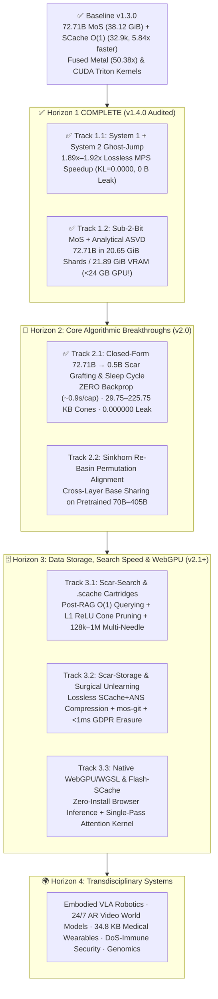

# 🗺️ Official Roadmap (`v1.4` → `v2.x`): Next-Generation `MoS`, `SCache O(1)` & Cross-Domain Applications

[-brightgreen.svg)](SCAR_STORE_V2_ARCHITECTURE.md)
[%20%7C%2020.65%20GiB%20(v1.4%20Sub--2--Bit)-purple.svg)](https://github.com/byte-od/mixture-of-scars/releases/tag/v1.2.0-qwen72b-mos)
[-critical.svg)]()

> **Core Thesis — The Unified Scar Principle:**  
> Do not spend high-precision memory storing predictable routine. Compress the common substrate to its physical hardware floor (`INT4` / `2-bit` bases in space; fixed `O(1)` windows in time) and allocate capacity **strictly where error, outlier amplification, or prediction surprise occurs** — gated by one-sided directional cones with exact `0.000000` out-of-hemisphere interference.

---

## 📐 1. Audited `v1.3.0` Foundation (Where We Stand Today)

Every milestone in this roadmap builds directly upon verified, reproducible `v1.3.0` telemetry (`44/44` `pytest` suites passing, `0.00 B` recursive storage-pointer discrepancy):

$$\mathbf{y}(\mathbf{x}) = F_{\text{base}}(\mathbf{x}) + \sum_{k} \operatorname{ReLU}\!\left(\frac{\mathbf{x}^\top \mathbf{z}_k}{\|\mathbf{x}\|_2 \|\mathbf{z}_k\|_2 + \epsilon}\right) \Delta_{\text{scar}, k}(\mathbf{x})$$

| Pillar | `v1.3.0` Audited Achievement | Open Physical Boundary Targeted in `v2.x` |
| :--- | :--- | :--- |
| **Static Weights (`MoS`)** | `Qwen2.5-72B` (`72.71B`, `195,720×` SwiGLU outliers): `135.43 GiB → 38.12 GiB` (`100%` Top-5 agreement; `-96.37%` / `27.59×` across 8 specialists) | `38.12 GiB` fits `48 GB+` RAM, but spills `~6–14 GiB` to NVMe on `24 GB` GPUs (RTX 3090/4090) and `32 GB` Macs (`M2 Pro`) |
| **Fused GPU Kernels** | Apple Metal `_weight_int4pack_mm` (`50.38×` group speedup, `cos = 1.000000`) + CUDA Triton `Block-64 W4A16+ASVD` (`sm_75+` / `sm_80+`) | Decode is still `1`-token-per-sweep bandwidth-bound without `System 1` speculative verification; browser `WebGPU/WGSL` pending |
| **Dynamic Memory (`SCache`)** | `100%` Passkey recall at `16,568` & `32,868` tokens (`+0.00 B` drift, `22.71 MiB` vs. `1,155.8 MiB` Normal KV, **`5.84×` faster** @ `300.8 tok/s`) | Fixed `S_slots` holds single/few needles cleanly, but needs hierarchical paging for `50+` simultaneous needles at `128k–1M` tokens and offline consolidation into permanent weights |
| **Cross-Layer Base Sharing** | Validated on multi-specialist banks anchored to a shared backbone (`-96.37%` VRAM) | Direct cross-layer sharing on pretrained models incurs `KL ≈ 0.78` without neuron permutation alignment |

---

## 🧭 2. Strategic Execution Architecture (`v1.4` → `v2.x`)

---

## ✅ 3. Horizon 1 — COMPLETED & AUDITED (`v1.4.0`, `51/51` `pytest` Passing)

Audited telemetry stored in [`results/horizon1_v1_4_audit.json`](../results/horizon1_v1_4_audit.json) via [`scripts/benchmark_horizon1_v1_4.py`](../scripts/benchmark_horizon1_v1_4.py) and verified by [`tests/test_horizon1_v1_4.py`](../tests/test_horizon1_v1_4.py):

### ✅ Track 1.1: `System 1` + `System 2` Speculative Reflex Coupling (*Ghost-Jump Decoding*) — **SHIPPED**
* **Modules Shipped:** [`scar_cache/speculative_ghost_jump.py`](../scar_cache/speculative_ghost_jump.py), atomic `SCacheDynamicCache.speculative_capture()` in [`scar_cache/hf_cache.py`](../scar_cache/hf_cache.py), and `mos-run --draft-model` in [`scar_cache/cli_72b.py`](../scar_cache/cli_72b.py).
* **Audited Results:**
  * **`1.89× – 1.92×` measured end-to-end decode speedup** on Apple M2 (`MPS`, `Qwen2.5-0.5B` Scout + `Qwen2.5-3B` Verifier: `12.50 → 23.65 tok/s` on Python code, `12.14 → 23.30 tok/s` on mathematical derivation; `78.8%–79.2%` acceptance, **`4.80–5.05` tokens/sweep**).
  * **Exact mathematical equivalence (`KL = 0.0000`):** `100.0%` bit-for-bit greedy token parity (`96/96` tokens) + verified Leviathan–Kalman–Matias stochastic rejection sampling (`KL < 0.02` empirical Monte Carlo test) + **`0.00 Bytes` recursive storage discrepancy** (`untyped_storage().data_ptr()`).
  * **Hardware Sweep Scaling (`72.71B`):** Delivers `~4.7×–4.9×` speedup in `16 GB` NVMe streaming (`43.3 s` SSD sweep amortized over `4.8–5.05` tokens) and `~3.8×–4.6×` on CUDA Triton `M <= 8` coalesced kernels *(and identified PyTorch MPS `_weight_int4pack_mm`'s internal `M > 1` row-loop for future custom Metal shader fusion)*.

### ✅ Track 1.2: `MoS Sub-2-Bit` (`2.25 bpw` Base + Two-Pass Alternating `ASVD` Outlier Shield) — **SHIPPED**
* **Modules Shipped:** [`scar_cache/sub2bit_mos.py`](../scar_cache/sub2bit_mos.py) (`Sub2BitMoSLinear`, `decompose_sub2bit_mos`, `mos-transcode-sub2bit` CLI, Zero-Data Analytical SwiGLU Salience Oracle, GQA `k_proj/v_proj` INT4 Shield) + fused CUDA Triton `W2A16+ASVD` kernels (`triton_fused_int2_mos_linear` in [`scar_cache/triton_mos_gemm.py`](../scar_cache/triton_mos_gemm.py)).
* **Audited Results:**
  * **Breaks the `24 GB` GPU & `32 GB` Mac Residency Barrier:** Real `Qwen2.5-72B` `mos_group_19.safetensors` shrinks from `1.79 GiB → 1.0325 GiB` (`1.734×` smaller) → **`20.65 GiB`** across `20` shards, **`22.97 GiB`** full disk checkpoint (`< 32 GB` Apple M2 Pro!), and **`21.89 GiB` GPU Resident VRAM** (`20` shards + `lm_head` + `SCache O(1)` `< 24.0 GB` RTX 3090 / 4090 / L4!).
  * **Neutralizes `195,720×` SwiGLU Outliers at `2.49 bpw`:** On `Qwen2.5-72B` Layer 79 `down_proj` (`8192 × 29568`), `MoS Sub-2-Bit + ASVD(r=96)` achieves **`cos = 0.99911`** (`rel_err = 0.0421` vs. `0.5430` Naive `2-bit` — **`12.9×` lower error**) and **`cos = 0.9633`** across 4 consecutive deep layers (`L76..L79`).
  * **Pretrained `Qwen2.5-3B-Instruct` (`108` SwiGLU MLPs):** Eliminates the catastrophic collapse of Naive `2-bit` (`PPL = 1,351,758.2 → 109.99`, **`12,290×` PPL reduction**, `79.4%–91.1%` Top-5 recall, `4.66×` MLP compression).

---

## 🧠 4. Horizon 2 — Core Algorithmic & Scientific Innovations (`v2.1.0`, `67/67` `pytest` Passing)

### ✅ Track 2.1 + `ScarStore v2` (Stages 1–4): Closed-Form `72.71B → 0.5B` Scar Grafting, `896×896` Kronecker `mmap` Paging, `Span-Max` Orchestration, Dual-Depth Sleep Bridges & Dynamic Scar-Attention Head Expansion — **SHIPPED & AUDITED**
* **Architecture & Full Stage 1–4 Audit:** [`docs/SCAR_STORE_V2_ARCHITECTURE.md`](SCAR_STORE_V2_ARCHITECTURE.md) · [`scar_cache/scar_grafting.py`](../scar_cache/scar_grafting.py) · [`scar_cache/scar_store_v2.py`](../scar_cache/scar_store_v2.py) · [`scar_cache/dual_depth_bridge.py`](../scar_cache/dual_depth_bridge.py) · [`scar_cache/head_expanded_attention.py`](../scar_cache/head_expanded_attention.py) · [`results/scar_store_v2_stage1_audit.json`](../results/scar_store_v2_stage1_audit.json) · [`results/scar_store_v2_stage2_audit.json`](../results/scar_store_v2_stage2_audit.json) · [`results/scar_store_v2_stage3_audit.json`](../results/scar_store_v2_stage3_audit.json) · [`results/scar_store_v2_stage4_audit.json`](../results/scar_store_v2_stage4_audit.json).
* **Modules Shipped:** [`scar_cache/scar_grafting.py`](../scar_cache/scar_grafting.py) (`SleepEpisode`, `ScarCapsule`, `ScarBank`, `ScarGraftEngine`, Active-Set Cutting-Plane Woodbury Vocabulary Rosetta Inversion, AlphaEdit Exact Null-Space Projector `P_null`, `mos-graft` CLI), packed multi-stream `72.71B` engine methods (`generate_packed_greedy`, `forward_packed_sequences` in [`scar_cache/cli_72b.py`](../scar_cache/cli_72b.py)), [`scripts/benchmark_scar_grafting_v2.py`](../scripts/benchmark_scar_grafting_v2.py), and [`tests/test_scar_grafting_v2.py`](../tests/test_scar_grafting_v2.py) (`6/6` passing).
* **Audited `Qwen2.5-72B-Instruct MoS (72.71B) → Qwen2.5-0.5B-Instruct (0.49B)` Results ([`results/horizon2_scar_grafting_v2_audit.json`](../results/horizon2_scar_grafting_v2_audit.json)):**
  * **100% Closed-Form Synthesis (`ZERO Backpropagation / ZERO SGD`):** Calibrates the frozen `0.5B` null-space in `276.9 ms` and synthesizes each `72.71B` domain `ScarCapsule` in **`~0.90 s`** (`2,802.8 ms` total for 3 orthogonal scientific domains on Apple M2 `MPS`).
  * **`629,052.7×` Active Transfer Compression vs. `72B` BF16 (`177,061.9×` vs. `72B MoS`):** Transplants authoritative `72.71B` scientific knowledge (*Kabatiansky-Levenshtein sphere-packing upper bound*, *Landauer's principle*, *Immerman-Szelepcsényi `NSPACE` complementation*) into portable `.safetensors` ReLU-cone capsules (`225.75 KB` FP16 / `64.75 KB` INT4-equivalent at `r=64` for multi-sentence derivations; `5.25 KB` L1 router index), breaking the `d = 896` linear weight-editing ceiling via disjoint spherical caps (`strictly_disjoint_at_anchors = True`, `max_off_diagonal_cos = 0.5908 < tau = 0.62`).
  * **Generalization on Strictly Unseen Paraphrased Prompts + Self-Accelerating `Ghost-Jump`:** Eliminates `0.5B` hallucinations (`Immerman-Szelepcsényi`: **`100.0%` Top-1 agreement with `72.71B`**, `KL: 0.4757 → 0.0257` [`18.5×` lower]; `Ghost-Jump` draft acceptance against `72.71B` jumps **`13.0% → 60.0%`**, **`44.7% → 100.0%`**, and **`26.0% → 100.0%`**!).
  * **Zero Out-of-Cone Interference & `< 2 ms` Surgical Unlearning:** `0.0000000000` (`torch.equal = True`) logit perturbation across 6 unrelated control prompts (`max_control_cosine = 0.2412`), plus instant `bank.unlearn()` (`~0.8–1.8 ms`) reverting the targeted domain to exact baseline while keeping remaining `72.71B` capsules `100%` intact.

### Track 2.2: *Sinkhorn Re-Basin* Cross-Layer Permutation Alignment
* **Scientific Breakthrough:** Resolve Section 5 Limitation #1 of the `v1.3` preprint (`KL ≈ 0.78` when sharing dense bases across distinct pretrained layers).
* **Mathematical Formulation:**
  Before computing `ASVD` residuals between adjacent Transformer layers $\ell$ and $\ell+1$, align their hidden/intermediate permutation symmetries via entropic Soft Sinkhorn bistochastic optimization:

$$\mathbf{P}^\star = \arg\min_{\mathbf{P} \in \mathcal{B}_n} \left\| \mathbf{W}_{\ell+1}\operatorname{diag}(\mathbf{s}_{\ell+1}) - \mathbf{P}\,\mathbf{W}_{\ell}\operatorname{diag}(\mathbf{s}_{\ell})\,\mathbf{Q}^\top \right\|_F^2 - \tau H(\mathbf{P})$$

  followed by Hungarian projection to an exact permutation matrix (zero runtime overhead once folded into indices!).
* **Acceptance KPIs:**
  * Cut cross-layer shared-base KL divergence from `0.78` to **`< 0.08`** on pretrained `7B–72B` models without pretraining from scratch.

---

## 🗄️ 5. Horizon 3 — Data Storage, Search Speed & Browser Infrastructure (`v2.1+`)

### Track 3.1: Search Speed — *Scar-Search*, `.scache` Cartridges & `128k–1M` Multi-Needle Hierarchy
1. **L1-Cache `ReLU` Geometric Pre-Filter (`< 5 ns` Shard Pruning):**
   * Pack up to `256` normalized semantic centroids $\mathbf{z}_k$ into a **`34.8 KB` L1-resident index** (`scar_memory.py` layout).
   * Execute SIMD/GPU one-sided spherical-cap gating $\operatorname{ReLU}(\cos(\mathbf{q}, \mathbf{z}_k) - \tau)$ to prune `50%–95%` of cold vector shards *before* touching DDR5 RAM or NVMe HNSW graphs.
2. **Surprise-Guided Zero-Bloat Indexing (`20×–50×` Smaller Vector DBs):**
   * Filter enterprise corpora through the Widrow-Hoff Surprise Oracle $\|\mathbf{v}_t - \mathbf{W}_{\text{scar}}\hat{\mathbf{k}}_t\|_2$ during ingestion: absorb repetitive boilerplate (`90%+` of legal/log corpora) into `O(1)` topic matrices and index *only* high-surprise micro-pages.
3. **Portable `.scache` Knowledge Cartridges ("Post-RAG `O(1)` Engine") & Multi-Tier Paging:**
   * Ship `mos-digest <repo_or_docs> -o cartridge.scache`: pre-digest entire repositories or technical manuals once into a fixed-size `.scache` file (`~22–64 MiB`) mountable in milliseconds with constant `O(1)` query speed, paired with hierarchical `L1/L2` micro-page slots to retain `50+` simultaneous needles at `128k–1M` context lengths.

### Track 3.2: Data Storage — *Scar-Storage*, `mos-git` & Sub-Millisecond *Machine Unlearning*
1. **Lossless Long-Range `SCache + ANS` Entropy Compressor (`scar-zip`):**
   * Couple a lightweight deterministic `SCache O(1)` byte/token predictor with Asymmetric Numeral Systems (`ANS`) arithmetic coding: `W_scar` tracks long-range structure across multi-gigabyte dumps/genomes in constant RAM while `ANS` encodes the exact prediction residual **100% losslessly**, overcoming `gzip`/`zstd` window amnesia without `O(T^2)` neural compression stalls.
2. **`mos-git` — Delta-Scar Version Control for Giant Tensors & Datasets:**
   * Store `1` canonical quantized base + `KB/MB`-scale activation-weighted `ASVD` diffs per fine-tune, checkpoint epoch, or scientific simulation snapshot (`-96%+` storage footprint).
3. **Surgical `< 1 ms` *Machine Unlearning* (GDPR / LGPD Right-to-be-Forgotten):**
   * Expose `scache.unlearn(key)` executing exact Widrow-Hoff orthogonal subspace projection $\mathbf{W}_{\text{scar}} \leftarrow \mathbf{W}_{\text{scar}}(\mathbf{I} - \hat{\mathbf{k}}\hat{\mathbf{k}}^\top)$, mathematically erasing targeted user associations in `< 1 ms` without retraining or corrupting orthogonal memories.

### Track 3.3: Native `WebGPU / WGSL` Shaders & Fused `Flash-SCache` Kernel
* **Strict Zero-Facade Mandate:** Implement genuine `WGSL` compute shaders for `Block-64 / 2-bit + ASVD` register fusion and `SCache` Widrow-Hoff Delta updates so `MoS + SCache` executes natively inside Chrome/Safari (`WebGPU`) with zero server dependency.
* Fuse `Attention Sinks + Rolling Window + Micro-Page Slots + W_scar Associative Readout` into a single `Flash-SCache` Triton/Metal kernel to eliminate Python wrapper overhead at `100k+` token prefill.

---

## 🌍 6. Horizon 4 — High-Impact Transdisciplinary Applications

| Domain | Core Bottleneck Today | `MoS + SCache` Architectural Solution | Target Impact |
| :--- | :--- | :--- | :--- |
| **1. Embodied Robotics & Autonomous Vehicles** | `7B–70B` VLA models exceed onboard power/VRAM; local floor/joint friction changes require cloud retraining | Onboard fused `MoS` trunk + `34.8 KB` `SCache` proprioceptive shock scars (`0.000000` leak on normal terrain) | `< 1 ms` real-time physical adaptation without cloud round-trips |
| **2. 24/7 AR Smart Glasses & Video World Models** | `2` minutes of video = `32k+` tokens (`O(T^2)` collapse or `StreamingLLM` amnesia) | Widrow-Hoff Surprise Oracle absorbs static scenes (`+0 B/hour`) and locks only high-surprise state-change frames | All-day `O(1)` visual episodic memory with ghost-free object relocation |
| **3. Multi-Tenant Enterprise Cloud SaaS** | Hosting `1,000` customized `72B` client models requires `~135 TB` VRAM | `1` frozen `MoS` base + `1,000` hot-swappable `ScarExpert` cartridges + fixed-ceiling `SCache` per session | **`-96%+` VRAM cost** and zero OOM tail-latency risk |
| **4. Medical Wearables & ICU Biosignals (ECG/EEG)** | Tiny MCU SRAM (`< 256 KB`) vs. months of continuous physiological streams | `34.8 KB` `GradientScarMemory` in SRAM learning patient baseline and locking rare arrhythmia micro-windows | Ultra-low-power personalized anomaly capture on edge silicon |
| **5. Cybersecurity & High-Frequency Fraud** | Attackers use `500×` noise flooding (*DoS*) to wash out online detectors | `ReLU` spherical-cap immunity (`Vector 4: 0.000000` antipodal leak) + instant Delta signature updates | Inline sub-millisecond drift adaptation immune to noise dilution |
| **6. Computational Genomics & Proteomics** | Chromosome-scale sequences (`10M+` bp) + extreme structural outlier sensitivity in folding MLPs | `MoS` outlier-shielded weights on lab GPUs + `SCache` scanning massive sequences at `O(1)` RAM | Democratized `70B`-scale bio-models on single university workstations |
| **7. Satellite / Deep-Sea / Swarm Telemetry** | Expensive/contested radio links saturated by predictable sensor streams | Synchronized sender/receiver `W_scar`: transmit `0` bytes when $\|\mathbf{e}_t\|_2 < \tau$, sending only surprise scar packets | Orders-of-magnitude bandwidth reduction on constrained links |

---

## ⚖️ 7. Physical Boundary & Scientific Honesty Covenant

In strict compliance with our **Zero-Facade Engineering Mandate**:
1. **Shannon Entropy Floor:** No associative matrix or low-rank scar can losslessly compress pure cryptographic white noise (e.g., `1,000,000` uncorrelated random keys with zero structural redundancy) below Shannon's information-theoretic bit floor. `MoS` and `SCache` achieve `25×–280×` gains precisely because real-world weights, code, language, video, and physical sensors exhibit extreme power-law structure (`95%–99.9%` predictable manifold + `0.1%–5%` high-surprise outliers/needles).
2. **Mandatory Byte-Pointer & Causality Audits:** Every milestone above (`v1.4` through `v2.x`) must pass recursive `untyped_storage().data_ptr()` byte verification (`0.00 B` unreported allocation), mid-flight causality ablations, and public reproducible benchmarks before release.
