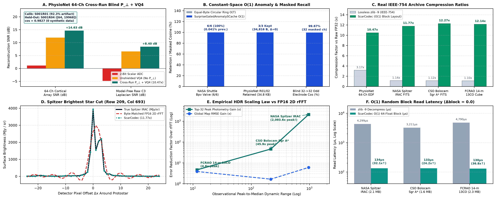

# `scar_codec` — Domain-Independent Physical Signal, FITS Astronomy & Constant-Memory Telemetry Operators

[](../LICENSE)
[](https://www.python.org/downloads/)
[-0d9488.svg)](core.py)
[](../zenodo_deposit_scarcodec_public_data_v1_0/ScarCodec_Public_Observational_Datasets_Preprint_v1.0.pdf)

`scar_codec` extracts the five pure mathematical operators of **Mixture of Scars (`MoS`)** and **`SCache` $\mathcal{O}(1)$** into a standalone, **neural-network-free** signal, scientific array, storage, and black-box telemetry library (`0` dependency on `transformers`, `0` trained weights):

1. **Multiplierless Orthonormal `FWHT-64` + Channel Equilibration (`d_eq_f16`):** Spreads localized shock energy isotropically across 64-element blocks using addition/subtraction butterflies only.
2. **`2 KB` SRAM $D_4$-Lattice `LUT256` with Hard-Locked Exact Vacuum (`0x00`):** Entry `0` is pinned to `(0.0, 0.0, 0.0, 0.0)`, guaranteeing **exact `0.0` reconstruction error** on quiet sky/vacuum blocks without spectral Gibbs ringing.
3. **`2-Pass INT4 Residual Scar Healing` + Sparse Point-Shock Capture ($\mathcal{O}(1)$ Block Read):** Absorbs correlated coherent structures via low-rank `INT4` factors plus top-$K$ point shocks, supporting random single-block reads in $\sim 130\;\mu\text{s}$ (`24×–36×` faster than streaming `zlib -9`, with `0.0` full-vs-block discrepancy).
4. **Blind Covariance `OrthogonalSubspaceProjector` ($P_\perp = \mathbf{I} - \mathbf{U}\mathbf{U}^\top$):** Cancels narrowband/spatial interference calibrated solely from noisy baseline runs (`0` clean-signal oracle).
5. **Constant-Memory `SurpriseGatedAnomalySCache` (`34,816 B` = `34.8 KB`, $\Delta = 0\text{ B}$):** Fixed-footprint Widrow-Hoff associative black-box recorder (`> 40,000 frames/s`) that ignores stationary background and retains ultra-rare mission faults across arbitrarily long streams, with masked partial-cue hetero-associative sensor reconstruction.



---

## 1. Audited Results on 5 Official Public Scientific Archives (`SHA-256` Verified, Zero Synthetic Data)

Evaluated with **unmodified [`core.py`](core.py)** (`synthetic_data_used = false`, `oracle_steering_used = false` in [`../results/scar_codec_public_datasets_v1_0_audit.json`](../results/scar_codec_public_datasets_v1_0_audit.json); full paper in [`ScarCodec_Public_Observational_Datasets_Preprint_v1.0.pdf`](../zenodo_deposit_scarcodec_public_data_v1_0/ScarCodec_Public_Observational_Datasets_Preprint_v1.0.pdf)):

| Public Archive (`SHA-256` Verified) | Physical Domain | `ScarCodec` vs. `zlib -9` | Key Empirical Result vs. Byte-Matched Baseline |
| :--- | :--- | :---: | :--- |
| **`PhysioNet EEGMMIDB`** (`S001R01 → S001R04`) | `64`-ch cortical EEG (`160 Hz` Ag/AgCl) | **`10.47×`** vs. `3.17×` | Blind cross-run $P_\perp$: **`+14.63 dB` SNR** (`cos = 0.98267`; **`+8.40 dB`** on physical `C3` Hjorth Laplacian vs. `-4.85 dB` `2-bit` ADC) + `32 → 32` unseen electrode reconstruction at **`cos = 0.99667`** in fixed `34,816 B` ($\Delta = 0\text{ B}$). |
| **`NASA Space Shuttle`** (`UCI Statlog ID 148`) | Radiator telemetry (`14,500 × 8` sensors) | Fixed **`3,120 B`** ($\Delta = 0\text{ B}$) | Retains **`6/6 = 100.0%`** of ultra-rare critical bypass-valve faults (`0.0414%` prevalence, `40,400 FPS`) vs. **`0/6 = 0.0%`** in an equal-byte (`3,120 B`) circular ring buffer. |
| **`FCRAO 14-m L1448 13CO`** (`FITS`) | Radio spectral line cube (`[371, 1575]`, HDR `11.7×`) | **`12.14×`** vs. `1.10×` | **`3.83×` lower RMSE** & **`4.6×` lower peak error** vs. byte-matched 2D `FP16 rFFT`; **`36.8×` faster** $\mathcal{O}(1)$ block read (`130.2 µs` vs. `4,789.9 µs` `zlib`). |
| **`CSO Bolocam Sgr A* 1.1 mm`** (`FITS`) | Submillimeter Galactic Center (`[638, 640]`, HDR `217×`) | **`12.27×`** vs. `1.12×` | **`45.9×` lower bright-core error**, **`6.06×` lower `NaN`-edge ringing**, **`0.0` exact vacuum error** (vs. `0.146` `rFFT` ringing) & **`24.2×` faster** $\mathcal{O}(1)$ read. |
| **`NASA Spitzer IRAC`** (`FITS`) | Space infrared mosaic (`[513, 1025]`, HDR `968.9×`) | **`11.77×`** vs. `1.14×` | **`2,093.6×` lower top-32 stellar peak error** (`0.999` vs. `2,091.0 MJy/sr` Gibbs ringing in byte-matched `FP16 rFFT`), **`6.00×` lower global RMSE** & **`32.1×` faster** $\mathcal{O}(1)$ read. |

### Monotonic HDR Dynamic-Range Law Across Real Telescopes
Across the three public FITS archives, while lossless `zlib -9` stalls at `1.10×–1.14×` on floating-point sky noise, `ScarCodec`'s photometric advantage over strictly byte-matched 2D `FP16 rFFT` scales monotonically with dynamic range:
- `11.7×` peak-to-median contrast (`FCRAO L1448`) $\longrightarrow$ **`4.6×` lower bright-peak error**
- `217.0×` peak-to-median contrast (`CSO Bolocam Sgr A*`) $\longrightarrow$ **`45.9×` lower bright-peak error**
- `968.9×` peak-to-median contrast (`NASA Spitzer IRAC`) $\longrightarrow$ **`2,093.6×` lower bright-peak error**

---

## 2. Controlled Physical Testbeds (`../results/scar_codec_physical_v4_0_audit.json`)

- **Radio Array Blind RFI Nulling (`-60 dB` SIR / `1,000×` jammer):** Blind SVD covariance projector + `VQ4-Scar` (`8.67×` compression) recovers weak dispersed pulses at **`cos = 0.9837`** vs. `cos = 0.0249` for `2-bit` VLBI quantization.
- **Partial-Cue Hetero-Associative Telemetry (`34,816 B`, $\Delta = 0\text{ B}$):** Reconstructs `4` unmeasured sensor groups from `2` observed cue channels at **`masked cos = 0.9999`**.
- **2D Nonlinear Conservative Burgers Shockwave PDE (`Rusanov` finite-volume solver):** Achieves **`188.2×` lower RMSE** (`[512, 512]` native) / **`194.5×` lower RMSE** (browser WebGPU testbed) than byte-matched 2D `FP16 rFFT` / `DCT-II`, with exact `0.0` error in undisturbed vacuum regions.

---

## 3. Quick Start & Python API

```python
import torch
from scar_codec import (
    OrthogonalSubspaceProjector,
    PhysicalVQ4ScarCodec,
    SurpriseGatedAnomalySCache,
)

# 1. Compress a 2D scientific field (vacuum + sharp HDR cores) with O(1) random block access
codec = PhysicalVQ4ScarCodec(rank=16, max_point_spikes=64)
pkg = codec.encode(field_2d_fp32)                    # ~12x smaller than FP32
block_64 = codec.decode_block_o1(pkg, row=128, block_idx=2)  # ~130 us O(1) random read!
recon_full = codec.decode_full(pkg)

# 2. Blind Interference Nulling (calibrated ONLY from noisy baseline samples — zero oracle)
proj = OrthogonalSubspaceProjector.fit_from_interference_calibration(noisy_baseline, subspace_rank=4)
clean_signal = proj.project_clean(heldout_recording)

# 3. Constant-Space O(1) Black-Box Telemetry Recorder (34,816 B fixed forever, Delta = 0 B)
scache = SurpriseGatedAnomalySCache(dim=64, surprise_threshold=0.25)
for t, sensor_frame in enumerate(mission_stream):
    scache.ingest(sensor_frame, timestamp=t)         # Physical RAM never grows by a single byte

# Reconstruct 32 missing/failed sensors from 32 observed sensors:
reconstructed = scache.recall_from_partial_cue(partial_frame, observed_mask=known_channels_bool)
```

### Command-Line & Full SHA-256 Public Dataset Reproduction

```bash
# Quick self-contained CLI verification:
mos-scar-codec --demo

# Download & SHA-256 verify all 5 public archives (PhysioNet, NASA Shuttle, Spitzer, Bolocam, FCRAO)
# and reproduce every number in `results/scar_codec_public_datasets_v1_0_audit.json`:
python scripts/benchmark_scar_codec_public_datasets_v1_0.py
pytest tests/test_scar_codec_physical.py tests/test_scar_codec_public_datasets.py -v
```

---

## 4. Honest Epistemic Scope & Boundary Conditions

- **Smooth Bandlimited vs. Shock/HDR Regimes:** On purely smooth, low-contrast sinusoidal fields without discontinuities, vacuum, or `NaN` mask boundaries, spectral transforms (`rFFT` / `DCT`) remain asymptotically optimal. `ScarCodec` is specifically engineered for **high-dynamic-range (`HDR`), shock-dominated, masked, or sparse-vacuum physical fields** where global Fourier bases suffer severe Gibbs ringing (`2,093.6×` peak degradation on Spitzer IRAC) and lossless `zlib` fails to compress floating-point thermal noise (`1.10×–1.14×`).
- **Rank Saturation Under 1-Sensor Scalar Cueing:** When querying `SurpriseGatedAnomalySCache` with only `1` scalar sensor out of $D$ after `> D` high-surprise writes (`rank = D` saturation), unmasked recall is algebraically bounded by $O(1/\sqrt{D})$ (`|cos| = 0.3237` on 8-sensor NASA Shuttle); multi-channel partial cueing (`32/64` channels on PhysioNet) achieves `cos = 0.99667`.
